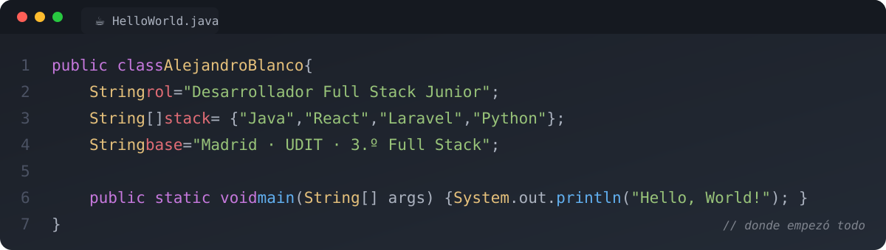

  

  
  
  
  

## `> whoami`

Técnico Superior en **DAM** y estudiante de **3.º de Desarrollo de Software Full Stack** en UDIT (Madrid).
Trabajo en front y back, con el front como punto fuerte, y me gusta entender cómo funciona todo por debajo.

- 🏆 **MedScan**: app con IA para evitar errores con la medicación. **4.º premio en el hackatón OdiseIA4Good**, con cobertura en RTVE, Antena 3 y El Español.
- 🧩 **VirtualpH · CSIC**: lead de frontend en una app de escritorio para monitorizar museos (Electron + React + Laravel + Docker).
- 🔁 Trabajo en equipo con **ramas, pull requests, revisión de código y CI** con GitHub Actions.
- 🎯 Busco **prácticas** con opción a media jornada compatible con mis estudios.

## `> stack`

  

  

  

## `> proyectos`

| Proyecto | Qué es | Stack |
|---|---|---|
| [**VirtualpH · CSIC**](https://github.com/alexxblaro16/proyecto-csic) | App de escritorio para monitorizar sensores y pH en museos. Lead de frontend. | Electron · React · Tailwind · Laravel · Docker |
| [**PyKV**](https://github.com/alexxblaro16/software-engineering) | Base de datos clave-valor (log append-only + índice hash, estilo Bitcask) hecha en equipo. | Python · pytest · GitHub Actions |
| [**Helios Deck**](https://github.com/alexxblaro16/helios-deck) · [demo](https://helios-deck-liard.vercel.app) | Dashboard que agrega datos abiertos de USGS, NOAA y NASA en tiempo real. | TypeScript · React Router 7 (SSR) · Three.js |
| [**API de eventos**](https://github.com/alexxblaro16/eventos-api-udit) | API REST de una plataforma de eventos con tests. | Laravel · PHP · Docker |
| [**Bibliotheca**](https://github.com/alexxblaro16/Bibliotheca.Alexxblaro-System.Catalog) | CRUD con Google Books y OpenLibrary para las portadas. | Laravel · Docker |
| [**AED 2**](https://github.com/alexxblaro16/aed2-udit) | Árboles, grafos, heap, tabla hash propia y Dijkstra con memoria gestionada a mano. | C++20 · CMake |
| [**Jerry EV3**](https://github.com/alexxblaro16/jerry-ev3) | Robot LEGO EV3 para siguelíneas, sumo y mando web desde el móvil. | MicroPython |

## `> actividad`

<picture>
  <source media="(prefers-color-scheme: dark)" srcset="https://raw.githubusercontent.com/alexxblaro16/alexxblaro16/output/serpiente-oscura.svg">
  <source media="(prefers-color-scheme: light)" srcset="https://raw.githubusercontent.com/alexxblaro16/alexxblaro16/output/serpiente.svg">
  
</picture>

<code>// mi primer lenguaje fue Java, y mi primera línea, un Hello, World!</code>

